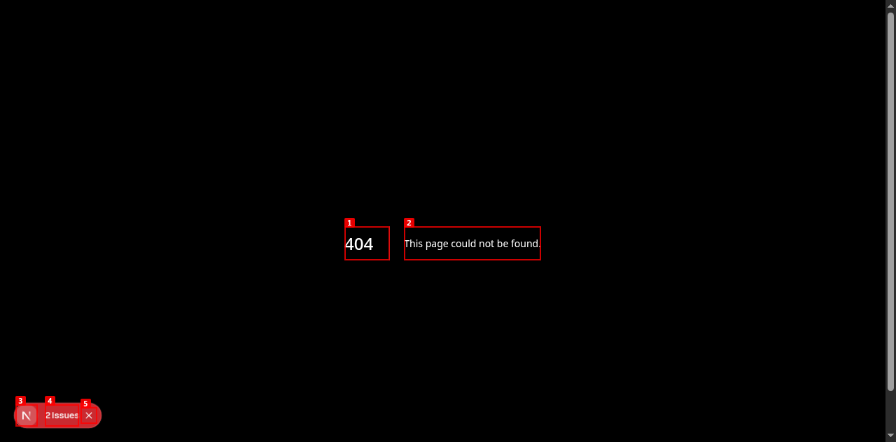
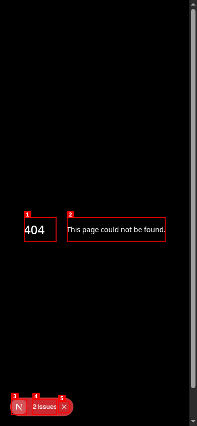
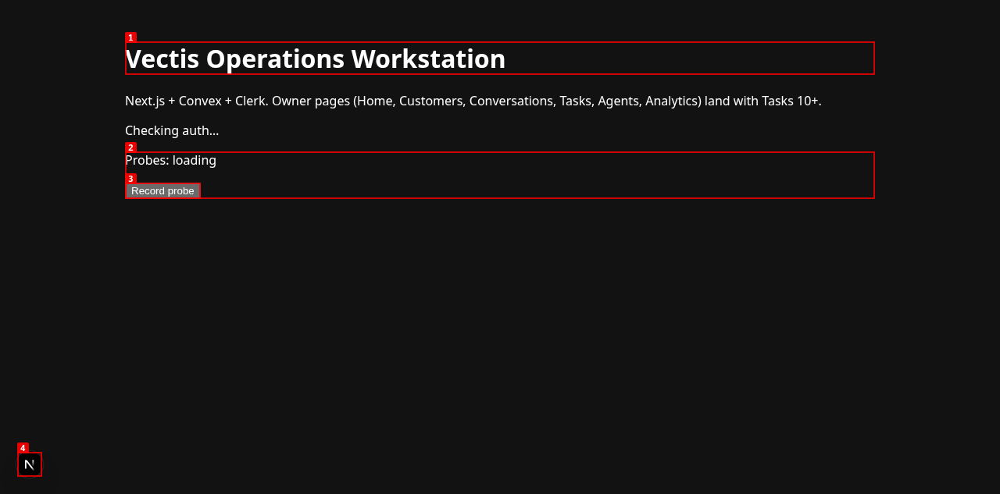
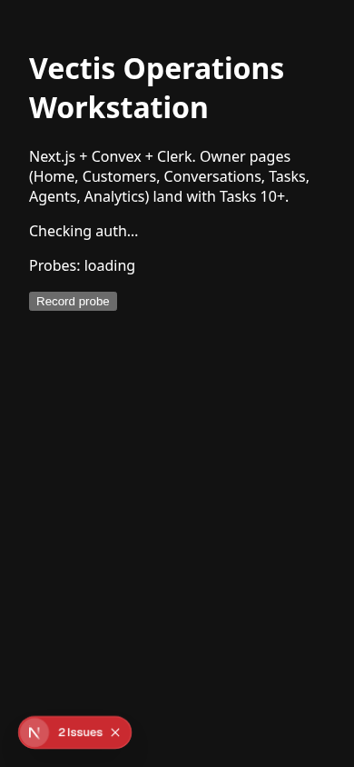
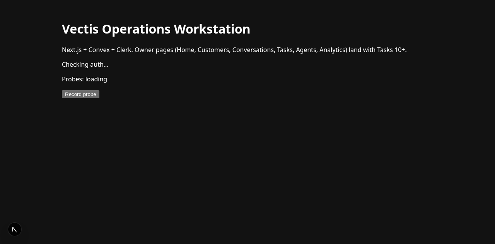

# Dogfood Report: Vectis Operations Workstation

| Field | Value |
|-------|-------|
| **Date** | 2026-08-31 |
| **App URL** | `http://localhost:3100` (`:3000` was already occupied by the Vectis Hermes WhatsApp bridge) |
| **Session** | `vectis-workstation` |
| **Scope** | Full current UI against the six owner destinations and six Admin/Operations destinations defined in `2026-08-29_141850-vectis-robust-mvp.md` |

## Summary

| Severity | Count |
|----------|-------|
| Critical | 2 |
| High | 3 |
| Medium | 1 |
| Low | 0 |
| **Total** | **6** |

## Executive assessment

The current checkout is not a bad implementation of the planned workstation; it is not yet the workstation at all. The only HTTP 200 page is a toolchain/probe screen. All 12 planned owner and operator destinations return 404. The root screen explicitly says the owner pages will arrive in “Tasks 10+,” stays on unresolved authentication/data-loading states, and exposes one diagnostic button with no visible result. There is no route from which an owner can inspect money, customers, calls, human work, agents, analytics, imports, campaigns, delivery state, integration health, live operations, or audit history.

## Issues

### ISSUE-001: All six owner destinations return 404

| Field | Value |
|-------|-------|
| **Severity** | critical |
| **Category** | functional |
| **URL** | `/home`, `/customers`, `/conversations`, `/tasks`, `/agents`, `/analytics` |
| **Repro Video** | N/A (static route failures) |

**Description**

The permanent owner navigation required by the plan does not exist. Direct navigation to every planned owner route returns Next.js's generic 404 page. A programmatic read-back confirmed 404 for all six routes. This blocks every core owner workflow and fails the Task 10 gate.

**Repro Steps**

1. Navigate to `/home`; observe the generic 404 page.
   
2. Navigate to `/customers`; observe the generic 404 page.
   
3. Navigate to `/conversations`; observe the generic 404 page.
   
4. Navigate to `/tasks`; observe the generic 404 page.
   
5. Navigate to `/agents`; observe the generic 404 page.
   
6. Navigate to `/analytics`; observe the generic 404 page.
   

---

### ISSUE-002: Every Admin/Operations destination returns 404

| Field | Value |
|-------|-------|
| **Severity** | critical |
| **Category** | functional |
| **URL** | `/operations/imports`, `/operations/campaigns`, `/operations/deliveries`, `/operations/integrations`, `/operations/live-operations`, `/operations/audit` |
| **Repro Video** | N/A (static route failures) |

**Description**

The secondary operator surface required to preserve consented import, campaign, delivery, integration-health, live-operation, and audit workflows is entirely absent. All six planned destinations return 404. A programmatic read-back confirmed 404 for all six routes.

**Repro Steps**

1. Navigate to `/operations/imports`; observe 404.
   
2. Navigate to `/operations/campaigns`; observe 404.
   
3. Navigate to `/operations/deliveries`; observe 404.
   
4. Navigate to `/operations/integrations`; observe 404.
   
5. Navigate to `/operations/live-operations`; observe 404.
   
6. Navigate to `/operations/audit`; observe 404.
   

---

### ISSUE-003: The root page is a developer probe, not an owner workstation

| Field | Value |
|-------|-------|
| **Severity** | high |
| **Category** | ux / content |
| **URL** | `/` |
| **Repro Video** | N/A (visible on load) |

**Description**

The only implemented page contains a framework-stack description, unresolved auth/probe statuses, and a diagnostic “Record probe” control. It explicitly says “Owner pages (Home, Customers, Conversations, Tasks, Agents, Analytics) land with Tasks 10+.” There is no permanent navigation, no Ask Vectis command bar, no owner summary, no attention queue, and no path into any business workflow. Visual review found large unused space, default-looking controls, development tooling, and no operational information hierarchy.

**Repro Steps**

1. Open `/`; observe the diagnostic shell and the text postponing all owner pages.
   
2. At 390x844, observe that the same unfinished diagnostic shell merely wraps to mobile; there is still no mobile navigation or workstation content.
   

---

### ISSUE-004: Authentication and reactive data stay indefinitely in loading states without recovery UI

| Field | Value |
|-------|-------|
| **Severity** | high |
| **Category** | functional / console / ux |
| **URL** | `/` |
| **Repro Video** | `videos/issue-003-repro.webm` |

**Description**

With the repository's documented synthetic public configuration, the page remains on “Checking auth…” and “Probes: loading.” Browser console evidence repeatedly reports `ClerkRuntimeError: Clerk: Failed to load Clerk` and Convex WebSocket close code 1006/reconnect loops. The UI never presents a sign-in state, a configuration error, retry guidance, or a bounded failure state. The current checkout has no `.env.local`, so there is also no available real local Clerk/Convex target with which to progress into the application.

**Repro Steps**

1. Start the current checkout with the documented synthetic public Convex and Clerk values and open `/`.
   
2. Wait for network idle and interact with the only control.
3. **Observe:** auth and probe statuses remain unresolved and no error/recovery UI appears.
   

---

### ISSUE-005: The only application control has no visible user-level effect

| Field | Value |
|-------|-------|
| **Severity** | high |
| **Category** | functional / ux |
| **URL** | `/` |
| **Repro Video** | `videos/issue-003-repro.webm` |

**Description**

Clicking “Record probe” produces no visible success, failure, pending state, count change, toast, or actionable error. The page remains “Probes: loading.” This violates the plan's non-negotiable rule that every visible control must have a durable, audited, browser-verifiable effect. Even as a toolchain probe, the control fails silently from the user's perspective.

**Repro Steps**

1. Open `/` and capture the initial state.
   
2. Click “Record probe.”
3. **Observe:** the UI is visually unchanged and supplies no result or failure feedback.
   

---

### ISSUE-006: The documented default development URL opens the Hermes WhatsApp bridge instead of the workstation

| Field | Value |
|-------|-------|
| **Severity** | medium |
| **Category** | functional / ux |
| **URL** | `http://localhost:3000/` |
| **Repro Video** | N/A (environment/startup conflict) |

**Description**

Port 3000 is already owned by `/home/map/.hermes/hermes-agent/scripts/whatsapp-bridge/bridge.js` for the active Vectis profile. Opening the README's implied default Next.js URL therefore returns `Cannot GET /` from the WhatsApp bridge, not the workstation. The workstation had to be started explicitly on port 3100. This is not the main product failure, but it makes the documented local run path misleading in the actual Vectis environment.

**Repro Steps**

1. Open `http://localhost:3000/` in the active Vectis environment.
2. **Observe:** the response is `Cannot GET /`, not the workstation.
   

## Plan-to-product gap

The plan's core promise was an owner-facing control plane that answers: “What did Vectis do for the business today, what needs attention, and what verified commercial outcome did it influence or recover?” The current browser surface answers none of those questions.

Missing browser-visible acceptance areas:

- Home money screen and attribution drill-down;
- canonical customer list/detail and unified timeline;
- voice conversations, summaries, outcomes, transcript/recording links, and handoffs;
- durable tasks/tickets with lifecycle, assignment, SLA, and resolution;
- business-facing agent registry, real health, outcomes, and safe campaign controls;
- date-scoped funnel and commercial attribution analytics;
- persistent Ask Vectis command/proposal/approval surface;
- imports, campaign details, deliveries, integrations, live operations, and audit;
- browser-visible authentication/tenant experience;
- mobile owner navigation and operational content;
- any browser-verifiable end-to-end workflow.

## Recommended recovery order

1. Stop treating the toolchain probe as the product home page. Build the permanent shell, six URL-backed owner routes, and Operations drawer first.
2. Deliver one real vertical slice rather than more horizontal backend scaffolding: Customers list → customer detail → call timeline → generated work item → evidence links.
3. Add the owner Home page only after commercial attribution drill-down sums are defensible; show explicit no-data/coverage states instead of guessed money.
4. Replace the probe button with real product controls and require visible pending/success/failure plus durable read-back for each.
5. Implement Ask Vectis as the planned durable command/proposal/approval lifecycle, not as a cosmetic input.
6. Configure and verify one protected Clerk + Convex development deployment, then run the browser acceptance matrix against authenticated owner/operator sessions.
7. Move the workstation's local development port away from the profile's WhatsApp bridge or document an explicit non-conflicting port.
